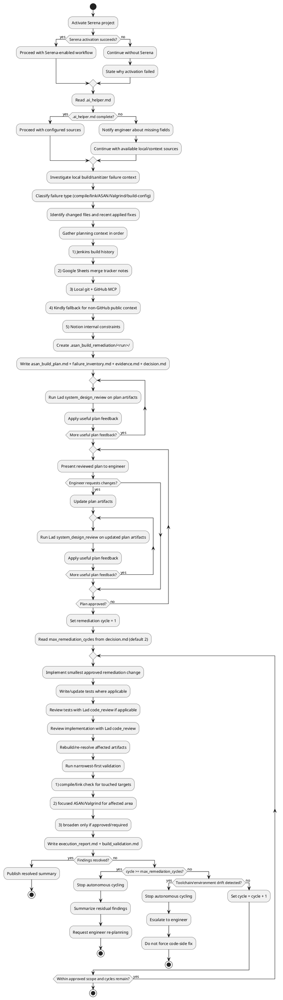

## Working Agreement

Use this skill when the blocker is a compile, linker, ASAN, Valgrind, or closely related build-validation failure in Percona merge workflows (PS, PXC, PXB) or in downstream workflows (EOL backports, customer repro, CVE remediation).
The workflow is plan-first and approval-gated: analyze build/sanitizer evidence, prepare a reviewed remediation plan, get engineer approval, then implement and revalidate only approved scope.

## Non-negotiables

1. **Scope**: Use this skill for compile, link, ASAN, Valgrind, or build-validation failures — not for normal test regressions.
2. **Plan before fix**: Create remediation artifacts first in `.asan_build_remediation/<YYYYMMDDTHHMMSSZ>_<short_context>/`.
3. **Approval gate**: Do not implement code changes until the plan is Lad-reviewed and explicitly approved by the engineer.
4. **Approved scope only**: Implement only the approved finding set and remediation actions.
5. **Read-only external systems**: Do not write/update external systems (Jenkins, Notion, GitHub, Google Sheets, Jira) from this skill.
6. **Narrowest-first build/sanitizer validation**: Run the smallest relevant build/check first; broaden only when required by the approved plan.
7. **Bounded autonomous loop**: If findings remain unresolved after bounded remediation cycles (default max `2`), stop and request engineer re-planning.
8. **Escalate on toolchain/environment drift**: If evidence points to toolchain or environment drift rather than a code issue, stop and escalate — do not force a code-side fix.

## Required Tooling

Use these tools when available. If unavailable, ask the engineer for exported evidence and continue with local artifacts.

### Serena
- Activate project first.
- Use repository navigation and memories for context and continuity.

### Lad
- `system_design_review`
- `code_review`

### GitHub (Read-only)
- `search_code`
- `get_file_contents`
- `list_commits`
- `get_commit`

### Kindly (Fallback For Non-GitHub Public Context)
- `web_search`
- `get_content`

### Google Sheets (Read-only)
- `sheets_get_metadata`
- `sheets_get_values`
- `sheets_batch_get_values`

### Jira (Read-only)
- `jira_search_issues`
- `jira_get_issue`
- `jira_download_attachments`
- `jira_batch_get_changelogs`

### Jenkins (Read-only)
- `query_items`
- `get_item`
- `get_build`
- `get_build_console_output`
- `get_build_test_report`
- `get_build_parameters`
- `get_running_builds`

### Notion (Read-only)
- `notion-search`
- `notion-fetch`

## `.ai_helper.md` Contract

**`.ai_helper.md` is for infrastructure pointers (server URLs, workspace IDs, repository identity) set up once. Per-invocation context (failure inputs, branch refs) comes from the engineer's prompt.**

Before external fetches, read repository-root `.ai_helper.md`.
It is the authoritative source for environment-specific pointers used by this skill.

### Infrastructure (set once, persists across invocations)

Expected sections/keys:
- `jenkins` (optional): `base_url`
- `google_sheets` (optional): `spreadsheet_id_or_url`, `sheet_name`, `ranges`
- `github` (optional): `owner`, `repo`
- `notion` (optional): `workspace_or_search_scope`, `page_ids_or_urls`
- `jira` (optional): `project_keys`, `jql_seed_queries`

### Per-invocation context

- `asan_build.failure_inputs` (optional): paths or links to build logs, sanitizer outputs, or other per-invocation evidence passed by the engineer in their prompt.
- `github.ref`: branch/tag/SHA for the specific invocation, supplied by the engineer in their prompt.

### Behavior on missing/incomplete `.ai_helper.md`
- Do not guess endpoints.
- Notify engineer about missing fields.
- Continue with local build/sanitizer evidence and available configured sources.

## ASAN Build Artifact Set

For each remediation run, create:
- `.asan_build_remediation/<YYYYMMDDTHHMMSSZ>_<short_context>/asan_build_plan.md`
- `.asan_build_remediation/<YYYYMMDDTHHMMSSZ>_<short_context>/failure_inventory.md`
- `.asan_build_remediation/<YYYYMMDDTHHMMSSZ>_<short_context>/evidence.md`
- `.asan_build_remediation/<YYYYMMDDTHHMMSSZ>_<short_context>/decision.md`

After implementation/validation, add:
- `.asan_build_remediation/<YYYYMMDDTHHMMSSZ>_<short_context>/execution_report.md`
- `.asan_build_remediation/<YYYYMMDDTHHMMSSZ>_<short_context>/build_validation.md`

Use UTC timestamp format `YYYYMMDDTHHMMSSZ` and snake_case `short_context`.
If the remediation folder already exists, append `_01`, `_02`, and so on until unique.

## Workflow (Step-by-step)

### 1) Initialize context and access

- Activate Serena if available.
- **Read artifact history context**: see `tdd` Step 1. (List subfolders from all 9 artifact folders, skip any that do not exist, sort by name descending, keep the top 300 in session context. Read folder contents reactively — only when a folder name seems relevant to the current problem.)
- Read `.ai_helper.md` for build/sanitizer failure pointers and optional external source pointers.
- If `.ai_helper.md` is incomplete, notify engineer and continue with available context.

### 2) Investigate local failure context

- Inspect local build logs, sanitizer outputs, and repository state.
- Classify failure type:
  - compile error,
  - linker failure,
  - ASAN error,
  - Valgrind error,
  - build-configuration issue.
- Identify changed files and recent applied fixes.
- Summarize deterministic vs ambiguous signals.

### 3) Gather planning context from external sources (strict order)

Use sources in this order during planning:
1. **Jenkins build history** (if configured) for prior build/sanitizer outcomes and recurrence patterns.
2. **Google Sheets merge tracker notes** (if configured) for similar past failures and resolutions.
3. **Local git + GitHub MCP** for upstream commit intent and changed-file history.
4. **Kindly fallback** for non-GitHub public context (for example upstream release notes, build-tool changelogs).
5. **Notion/internal process notes** (if configured) for toolchain constraints and caveats.

Record gathered evidence links/snippets in `evidence.md`.

### 4) Create remediation planning artifacts

- Create `.asan_build_remediation/<run>/`.
- Write `asan_build_plan.md`, `failure_inventory.md`, `evidence.md`, `decision.md`.
- In `asan_build_plan.md`, define:
  - `selected_failure_scope`
  - `root_cause_hypothesis`
  - `proposed_actions` (minimal fix, rollback, toolchain workaround — as applicable)
  - `narrowest_first_validation_sequence`
  - `rollback_or_fallback_conditions`
- In `failure_inventory.md`, list each failure item keyed by ID, type, affected artifact, and evidence reference.
- In `decision.md`, record:
  - `status` (`draft` or `approved`)
  - `approver`
  - `approved_scope`
  - `max_remediation_cycles` (default `2` unless approved otherwise)
  - `notes`

### 5) Validate assumptions and review plan with Lad

- Validate assumptions with local git evidence and GitHub MCP first.
- Use Kindly only when needed for non-GitHub public references.
- Update `asan_build_plan.md` and `evidence.md` when assumptions change.
- Run Lad `system_design_review` on planning artifacts.
- Apply worthwhile feedback until no material issues remain.

### 6) Ask engineer for explicit approval

- Present reviewed artifacts and proposed remediation order.
- Ask for explicit approval before implementation.
- If changes are requested, revise artifacts and repeat step 5.

### 7) Implement approved remediation

- Apply the smallest approved change first.
- Add/update tests where applicable.
- Review tests with Lad `code_review` if tests were written.
- Implement code change.
- Review implementation with Lad `code_review`.
- Keep changes within approved scope.

### 8) Validate with narrowest-first build/sanitizer checks and decide closure

- Read `max_remediation_cycles` from `.asan_build_remediation/<run>/decision.md` (default `2` if absent).
- Set remediation cycle = 1.
- Run narrowest approved validation first:
  1. affected object/file compile check,
  2. link check if applicable,
  3. focused ASAN/Valgrind run for touched area,
  4. broaden only if approved/required.
- Save results to `execution_report.md` and `build_validation.md` as cumulative run artifacts (append/update per cycle, do not discard prior cycle evidence).
- If findings are unresolved, increment remediation cycle by `1` and iterate only within approved scope and bounded cycles.
- If findings are resolved, publish resolved summary and stop.

### 9) Re-plan with engineer when needed

- If unresolved findings persist after `max_remediation_cycles`, or if evidence indicates toolchain/environment drift rather than a code issue, stop autonomous cycling.
- Summarize findings, residual risk, and required decision points for engineer re-planning.

## Workflow Outputs

Expected outputs:
- Lad-reviewed and engineer-approved ASAN/build remediation plan.
- Approved implementation changes within scope.
- Narrowest-first build/sanitizer validation evidence tied to the approved failure set.
- Clear resolved/unresolved summary with explicit escalation when needed.

## Workflow Activity Diagram (PlantUML)



## Usage Examples

```text
Analyze the current ASAN/build failure, create .asan_build_remediation artifacts, review the plan with Lad, and wait for my approval before implementation. Follow $percona_asan_build_remediation_tdd.
```

```text
Prepare an approval-ready ASAN/build remediation plan for this PXC merge fallout, then implement only the approved fix and run narrowest-first sanitizer validation. Follow $percona_asan_build_remediation_tdd.
```

## Serena memories (when supported)

Store useful ASAN/build remediation knowledge for future tasks:
- recurring sanitizer error patterns and reliable fixes,
- toolchain-specific caveats and constraints,
- safe minimal build/sanitizer revalidation command sets,
- approval and escalation decision patterns for environment vs code issues.
