## Working Agreement

Use this skill when the current blocker is merge-conflict interpretation and resolution in Percona merge workflows (PS, PXC, PXB).
The workflow is plan-first and approval-gated: build conflict artifacts, review with Lad, get engineer approval, then apply only approved resolution scope.

## Non-negotiables

1. **Scope**: Use this skill for merge-conflict and merge-stack conflict resolution, not for general feature delivery.
2. **Plan before code edits**: Create conflict artifacts first in `.merge_conflicts/<YYYYMMDDTHHMMSSZ>_<commit_hash>_<short_context>/`.
3. **Two-stage approval gate**:
- Stage 1: engineer approves the conflict plan. The agent **shows `git diff` output for each conflicted file** in the Claude Code console alongside the plan artifacts.
- Stage 2: engineer approves the concrete candidate resolution before source edits are applied. The agent **shows the exact hunk-level diffs** being resolved.
4. **Apply-mode choice**: Before applying resolution, the agent asks the engineer once whether to use **AI-apply** (agent edits files directly) or **mergetool** (agent opens `git mergetool` and waits for the engineer to resolve visually). The chosen mode is used for all subsequent resolution cycles in this run. If the engineer does not specify, default to mergetool.
5. **Approved scope only**: Apply only approved file/hunk decisions for the current conflict set.
6. **Read-only external systems**: Do not write/update external systems (Sheets, Jira, Notion, Jenkins, GitHub) from this skill.
7. **Local evidence first**: Resolve from local conflict state first, then use external context in defined order.
8. **Bounded autonomous loop**: If conflicts remain unresolved after bounded cycles (default max `2`), stop and request engineer re-planning.
9. **Escalate on ambiguity**: If multiple plausible resolutions materially change behavior and approval is missing, stop and escalate.

## Required Tooling

Use these tools when available. If unavailable, ask the engineer for exported evidence and continue with local artifacts.

### Serena
- Activate project first.
- Use repository navigation and memories for context continuity.

### Lad
- `system_design_review`
- `code_review`

### GitHub (Read-only)
- `search_code`
- `get_file_contents`
- `list_commits`
- `get_commit`

### Kindly (Fallback For Non-GitHub Public Context)
- `web_search`
- `get_content`

### Google Sheets (Read-only)
- `sheets_get_metadata`
- `sheets_get_values`
- `sheets_batch_get_values`

### Jira (Read-only)
- `jira_search_issues`
- `jira_get_issue`
- `jira_download_attachments`
- `jira_batch_get_changelogs`

### Notion (Read-only)
- `notion-search`
- `notion-fetch`

### Jenkins (Read-only, optional validation context)
- `query_items`
- `get_item`
- `get_build`
- `get_build_console_output`
- `get_build_test_report`
- `get_build_parameters`
- `get_running_builds`

## `.ai_helper.md` Contract

> **What this file is for:** `.ai_helper.md` stores **once-only infrastructure pointers** — stable identifiers and endpoint references that are set up once per repository and reused across many invocations. It is **not** a per-invocation input file. Product, target branch, release series, and GitHub ref are supplied by the engineer in their prompt on each use.

Before external fetches, read repository-root `.ai_helper.md`.
It is the authoritative source for environment-specific pointers used by this skill.

**Per-invocation context (supplied by the engineer in their prompt, not from `.ai_helper.md`):**
- `product` (`ps`, `pxc`, `pxb`)
- `target_branch`
- `release_series`
- `github.ref`

**Infrastructure pointers** (stable values set up once per repo):

Expected sections/keys:
- `google_sheets` (required for merge-tracker reads when available):
  - `spreadsheet_id_or_url`
  - `sheet_name`
  - optional `ranges`
- `jira` (optional but recommended for PXC/PXB):
  - optional `project_keys`
  - optional `jql_seed_queries`
- `github` (optional but recommended):
  - `owner`
  - `repo`
- `notion` (optional):
  - `workspace_or_search_scope`
  - optional `page_ids_or_urls`
- `jenkins` (optional):
  - `base_url`

Behavior on missing/incomplete `.ai_helper.md`:
- Do not guess endpoints or IDs.
- Notify engineer about missing fields.
- Continue the workflow with local evidence plus any configured/available sources.

## Conflict Artifact Set

For each conflict-resolution run, create:
- `.merge_conflicts/<YYYYMMDDTHHMMSSZ>_<commit_hash>_<short_context>/conflict_inventory.md`
- `.merge_conflicts/<YYYYMMDDTHHMMSSZ>_<commit_hash>_<short_context>/resolution_plan.md`
- `.merge_conflicts/<YYYYMMDDTHHMMSSZ>_<commit_hash>_<short_context>/evidence.md`
- `.merge_conflicts/<YYYYMMDDTHHMMSSZ>_<commit_hash>_<short_context>/decision.md`
- optional `.merge_conflicts/<YYYYMMDDTHHMMSSZ>_<commit_hash>_<short_context>/candidate_patch.diff`

After approved application and validation, add:
- `.merge_conflicts/<YYYYMMDDTHHMMSSZ>_<commit_hash>_<short_context>/applied_resolution.md`
- `.merge_conflicts/<YYYYMMDDTHHMMSSZ>_<commit_hash>_<short_context>/validation_report.md`

Use UTC `YYYYMMDDTHHMMSSZ` timestamp, the `<commit_hash>` from `git rev-parse` of the commit introducing the conflict (abbreviated 12-char SHA), and snake_case `short_context`.
If the run folder already exists, append `_01`, `_02`, and so on until unique.

## Workflow (Step-by-step)

### 1) Initialize context and classify conflict mode

- Activate Serena if available.
- **Read artifact history context**: see `tdd` Step 1. (List subfolders from all 9 artifact folders, skip any that do not exist, sort by name descending, keep the top 300 in session context. Read folder contents reactively — only when a folder name seems relevant to the current problem.)
- Read `.ai_helper.md` and validate available pointers.
- Classify current mode:
- **PS linear-port conflict** (single commit context usually available), or
- **PXC/PXB merge-stack conflict** (multiple interleaved conflicts may appear together).

### 2) Investigate local conflict state first

- Inspect local merge/conflict evidence: `git status`, conflicted files, conflict hunks, nearby history.
- Determine whether each issue is:
- obvious line-level merge, or
- feature-vs-feature semantic conflict requiring broader context.
- Seed `conflict_inventory.md` with conflict IDs/files and initial hypotheses.

### 3) Gather external context in strict order

Use sources in this order during planning:
1. **Merge tracking Google Sheets** for similar historical conflict outcomes.
2. **Jira issue context** (especially PXC/PXB bug-linked changes).
3. **Local git + GitHub MCP** for upstream/percona commit intent and file history.
4. **Kindly fallback** for non-GitHub public context (for example `bugs.mysql.com`, Oracle release-note pages).
5. **Notion/internal process notes** for constraints and caveats.

Operational detail for each source:

1. **Google Sheets** (`google_sheets.*` from `.ai_helper.md`)
- `sheets_get_metadata` for sheet structure.
- `sheets_batch_get_values` when `ranges` are provided.
- otherwise `sheets_get_values` for configured sheet/tab.

2. **Jira** (`jira.*` from `.ai_helper.md`)
- `jira_search_issues` using provided issue keys or JQL seeds.
- `jira_get_issue` for selected issue details.
- `jira_batch_get_changelogs` for timeline/context.
- `jira_download_attachments` when issue artifacts are relevant.

3. **Local git + GitHub MCP**
- Local first: `git log`, `git show`, `git blame`, `git diff` around conflicted areas.
- Then GitHub MCP:
- `search_code` for signatures/files.
- `list_commits` for upstream branch flow.
- `get_commit` for precise commit intent.
- `get_file_contents` for exact upstream path/ref reads.

4. **Kindly fallback only**
- `web_search` and `get_content` only when needed for non-GitHub public references.

5. **Notion** (`notion.*` from `.ai_helper.md`)
- `notion-fetch` for direct page IDs/URLs.
- `notion-search` then `notion-fetch` when only scope/keywords are provided.

Record all evidence links/snippets in `evidence.md`.

### 4) Build planning artifacts

- Create `.merge_conflicts/<YYYYMMDDTHHMMSSZ>_<commit_hash>_<short_context>/`.
- Derive `<commit_hash>` from `git rev-parse --short=12 HEAD` or the equivalent for the commit that introduced the conflict.
- If the run folder already exists, append `_01`, `_02`, and so on until unique.
- Write `conflict_inventory.md`, `resolution_plan.md`, `evidence.md`, `decision.md`.
- `resolution_plan.md` must start with **why the conflict exists** for each conflict item.
- Distinguish line-level vs feature-level conflicts and list selected resolution strategy plus alternatives.
- In `decision.md`, record:
- `status` (`draft_plan`, `approved_plan`, `approved_apply`)
- `approver`
- `approved_scope`
- `max_resolution_cycles` (default `2` unless approved otherwise)
- `apply_mode` (`ai-apply` or `mergetool` — set during step 7, persists for the run)
- `notes`

### 5) Review plan with Lad

- Run Lad `system_design_review` on planning artifacts.
- Apply worthwhile feedback until no material planning issues remain.

### 6) Request stage-1 engineer approval (plan)

- Present reviewed plan artifacts.
- **Show `git diff` output for each conflicted file** in the Claude Code console. Use `git diff` (or `git diff HEAD` / `git diff --check`) to render the actual conflict hunks the engineer will see in their editor. Present diffs alongside the plan narrative so the engineer can match each conflict to its proposed resolution strategy.
- Ask for explicit plan approval.
- If plan changes are requested, update artifacts and repeat step 5.

### 7) Prepare concrete candidate resolution and request stage-2 approval

- Prepare concrete candidate resolution for approved scope:
- update `resolution_plan.md` with exact hunk/file decisions,
- optionally produce `candidate_patch.diff` artifact.
- Run Lad `code_review` on the concrete candidate resolution artifact before requesting apply approval.
- **Show the exact hunk-level diffs** for each proposed resolution in the Claude Code console. For each conflict, show: the conflicted section (from `git diff`) followed by the proposed resolved version (from `candidate_patch.diff` or inline diff).
- Present candidate resolution and request explicit apply approval.
- If candidate changes are requested, update candidate artifacts and repeat this step.
- **Ask the engineer to choose apply mode** (once per run):
  - **AI-apply**: the agent edits files directly to apply the approved resolution.
  - **Mergetool**: the agent opens `git mergetool` (or the engineer's configured merge tool) and waits for the engineer to resolve visually.
  - Record the chosen mode as `apply_mode` in `decision.md`. If the engineer does not specify, default to `mergetool`.
  - The chosen mode applies to all subsequent resolution cycles in this run.

### 8) Apply approved conflict resolution

- Set `resolution_cycle = 1`.
- Read `max_resolution_cycles` from `decision.md` (default `2`).
- Read `apply_mode` from `decision.md` (set in step 7).
- If `apply_mode` is `ai-apply`: apply the smallest approved conflict edits directly. Review implementation changes with Lad `code_review`.
- If `apply_mode` is `mergetool`: call `git mergetool` to open the engineer's configured merge tool for each conflicted file, wait for the engineer to resolve all conflicts, then confirm the resolved state with `git diff` before proceeding to validation. The `candidate_patch.diff` serves as a reference: the agent summarizes which resolution strategy was used per file so the engineer can follow it in their merge tool.
- Record `apply_mode` and any relevant notes in `applied_resolution.md`.

### 9) Validate narrowest-first and decide closure

- Validate in narrowest relevant order:
1. build/compile check for touched targets,
2. focused test check for affected area,
3. broader checks only when approved/required.
- Optionally consult Jenkins historical runs for comparison context.
- Write `applied_resolution.md` and `validation_report.md`.
- If validation reveals out-of-scope fallout or unresolved semantic ambiguity, stop and request engineer re-planning.
- If unresolved issues remain but cycles are available, increment `resolution_cycle` and iterate within approved scope.

### 10) Re-plan with engineer when needed

- If unresolved after `max_resolution_cycles`, or if out-of-scope/ambiguous semantics emerge, stop autonomous cycling.
- Summarize residual issues and request explicit engineer re-planning direction.

## Workflow Outputs

Expected outputs:
- Lad-reviewed and engineer-approved conflict plan.
- Engineer-approved concrete resolution candidate.
- Applied conflict resolution within approved scope.
- Validation evidence and clear resolved/unresolved status with explicit escalation when needed.

## Workflow Activity Diagram (PlantUML)

```plantuml
@startuml
start

:Activate Serena project;
if (Serena activation succeeds?) then (yes)
  :Proceed with Serena-enabled workflow;
else (no)
  :Continue without Serena;
  :State why activation failed;
endif

:Read .ai_helper.md;
if (.ai_helper.md complete?) then (yes)
  :Proceed with configured sources;
else (no)
  :Notify engineer about missing fields;
  :Continue with local evidence and available sources;
endif

:Classify conflict mode (PS linear vs PXC/PXB merge-stack);
:Inspect local conflict state first;
:Seed conflict_inventory.md;

:Gather context in order;
:1) Merge Sheets;
:2) Jira context;
:3) Local git + GitHub MCP;
:4) Kindly fallback for non-GitHub public sources;
:5) Notion internal notes;

:Create .merge_conflicts/<YYYYMMDDTHHMMSSZ>_<commit_hash>_<short_context>/;
:Write conflict_inventory.md + resolution_plan.md + evidence.md + decision.md;

repeat
  :Run Lad system_design_review on plan artifacts;
  :Apply useful plan feedback;
repeat while (More useful plan feedback?) is (yes)

repeat
  :Present reviewed plan to engineer;
  :**Show git diff for each conflicted file in console**;
  if (Engineer requests plan changes?) then (yes)
    :Update plan artifacts;
    repeat
      :Run Lad system_design_review on updated plan artifacts;
      :Apply useful plan feedback;
    repeat while (More useful plan feedback?) is (yes)
  endif
repeat while (Plan approved?) is (no)

repeat
  :Prepare concrete candidate resolution;
  :Update resolution_plan.md and optional candidate_patch.diff;
  :Run Lad code_review on candidate artifact;
  :**Show hunk-level diffs (conflicted → proposed) in console**;
  :Present candidate to engineer;
repeat while (Apply approval granted?) is (no)

:Ask engineer: apply_mode = ai-apply or mergetool?;
note right: Default to mergetool if not specified;
:Record apply_mode in decision.md;

:Set resolution_cycle = 1;
:Read max_resolution_cycles from decision.md (default 2);
repeat
  if (apply_mode == ai-apply?) then (yes)
    :Apply smallest approved conflict edits directly;
    :Review implementation with Lad code_review;
  else (no: mergetool)
    :Open git mergetool for each conflicted file;
    :Summarize candidate_patch.diff strategy per file as reference;
    :Wait for engineer to resolve all conflicts;
    :Confirm resolved state with git diff;
  endif
  :Run narrowest validation (build/compile first, then focused tests);
  :Write applied_resolution.md + validation_report.md;

  if (Issue resolved?) then (yes)
    :Publish resolved summary;
    stop
  else (no)
    if (Out-of-scope fallout OR semantic ambiguity?) then (yes)
      :Stop autonomous cycling;
      :Summarize residual issues;
      :Request engineer re-planning;
      stop
    else (no)
      if (resolution_cycle >= max_resolution_cycles?) then (yes)
        :Stop autonomous cycling;
        :Summarize residual issues;
        :Request engineer re-planning;
        stop
      else (no)
        :Set resolution_cycle = resolution_cycle + 1;
      endif
    endif
  endif
repeat while (Within approved scope and cycles remain?) is (yes)

stop
@enduml
```



## Usage Examples

```text
Analyze current PS merge conflict hunks, build .merge_conflicts artifacts with source-backed rationale, review with Lad, and wait for my two-stage approval before applying edits. Follow $percona_conflict_resolution_tdd.
```

```text
For current PXC merge-stack conflicts, gather Sheets/Jira/git context, prepare a concrete candidate resolution per file, and apply only after explicit approval. Follow $percona_conflict_resolution_tdd.
```

## Serena memories (when supported)

Store useful conflict-resolution knowledge for future tasks:
- recurring conflict patterns and accepted resolution strategies,
- product/branch-specific caveats (PS vs PXC/PXB),
- reliable minimal validation commands for conflict checkpoints,
- approval and escalation patterns for ambiguous semantic conflicts.

If Serena memories are unavailable, rely on `.merge_conflicts/<YYYYMMDDTHHMMSSZ>_<commit_hash>_<short_context>/` artifacts for continuity.
