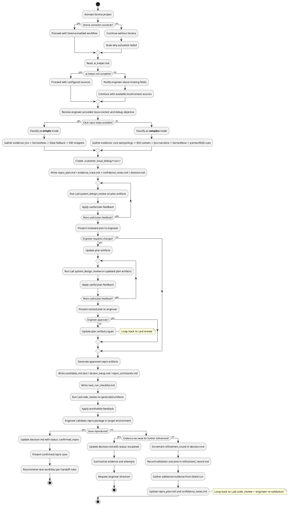

## Working Agreement

Use this skill when the blocker is the absence of a trustworthy reproduction package for a customer issue in Percona workflows.
The workflow is plan-first and approval-gated: gather customer evidence, classify the repro approach, prepare a reviewed repro plan, get engineer approval, generate the repro package, and iterate until the engineer confirms a stable reproducible case.

This skill is focused on reproduction, not on the final code fix.

## Non-negotiables

1. **Scope**: Use this skill for customer issue reproduction — converting issue context into executable repro packages — not for code fix implementation.
2. **Plan before repro**: Create reproduction artifacts first in `.customer_issue_debug/<YYYYMMDDTHHMMSSZ>_<short_context>/`.
3. **Approval gate**: Do not generate executable repro artifacts (MTR tests, Docker setups, repro commands) until the plan is Lad-reviewed and explicitly approved by the engineer. The "approved approach" is the `approved_approach` field recorded in `decision.md`. Subsequent refinements within the same approved approach require Lad `code_review` but do not require a full re-approval cycle. Changes within scope include: adjusting SQL literals or WHERE clause conditions, altering table structures or session variables, narrowing or broadening concurrency assumptions. If the refinement switches the repro strategy (for example, from an MTR test to a Docker command sequence, or from a single-statement repro to a multi-step scenario), re-enter the full approval gate.
4. **Engineer validation required**: The engineer must validate the generated repro package in the target environment. AI-driven validation is not sufficient to confirm a reproducible case.
5. **Read-only external systems**: Do not write/update external systems (Jira comments, ServiceNow incidents, Slack threads) from this skill unless the engineer explicitly requests it.
6. **Refinement loop is engineer-driven**: If the repro package fails to reproduce the issue, refine based on engineer feedback. The `refinement_round` counter in `decision.md` tracks iterations. After 3 refinement rounds without meaningful progress toward reproduction, escalate to the engineer for re-planning direction.
7. **Escalate on weak evidence**: If available evidence is insufficient to justify a plausible repro package, or if required environment access is unavailable, stop and escalate rather than producing low-confidence artifacts.

## Required Tooling

Use these tools when available. If unavailable, ask the engineer for exported evidence and continue with local artifacts.

### Serena
- Activate project first.
- Use repository navigation and memories for context and continuity.

### Lad
- `system_design_review`
- `code_review`

### Jira
- `jira_search_issues`
- `jira_get_issue`
- `jira_download_attachments`
- `jira_batch_get_changelogs`

### Kindly (Public Context)
- `web_search`
- `get_content`

### Google Sheets (Read-only)
- `sheets_get_metadata`
- `sheets_get_values`
- `sheets_batch_get_values`

### Notion (Read-only)
- `notion-search`
- `notion-fetch`

### ServiceNow (Future/Optional)
- `get_incident_by_number`
- `get_incident`
- `list_incidents`
- `add_comment_to_incident` — **DISABLED BY DEFAULT** — engineer must explicitly authorize writes
- `add_work_notes_to_incident` — **DISABLED BY DEFAULT** — engineer must explicitly authorize writes
- `attach_file_to_record` — **DISABLED BY DEFAULT** — engineer must explicitly authorize writes
- `search_records_by_text`

Until ServiceNow MCP is available, continue with engineer-provided exports, comments, and local evidence. When the MCP is available, write operations require explicit engineer authorization before any call.

### Repro Host / SSH (Future/Optional)
- `ssh_list_servers`
- `ssh_execute`
- `ssh_upload`
- `ssh_download`
- `ssh_tail`

Until repro-host SSH MCP is available, continue with engineer-provided command outputs, run results, and local evidence.

## `.ai_helper.md` Contract

`.ai_helper.md` is for infrastructure pointers (server URLs, workspace IDs, repository identity) set up once. Per-invocation context (issue key, repro assets, target environment) comes from the engineer's prompt.

Before external fetches, read repository-root `.ai_helper.md`.
It is the authoritative source for environment-specific pointers used by this skill.

Expected infrastructure sections/keys:
- `jenkins` (optional): `base_url`
- `google_sheets` (optional): `spreadsheet_id_or_url`, `sheet_name`, `ranges`
- `notion` (optional): `workspace_or_search_scope`, `page_ids_or_urls`
- `github` (optional): `owner`, `repo`
- `jira` (optional): `project_keys`, `jql_seed_queries`
- `repro_host` (optional): `host_aliases`, `access_notes`

Per-invocation context (from engineer's prompt, NOT from `.ai_helper.md`):
- `issue_key` — Jira issue key or ServiceNow incident number
- `target_environment` — target server version, platform, build configuration
- `repro_assets` — paths or links to core dumps, support logs, attachments
- `github.ref` — branch or tag to check out for the repro

Behavior on missing/incomplete `.ai_helper.md`:
- Do not guess endpoints or credentials.
- Notify engineer about missing fields.
- Continue with local evidence, engineer-provided exports, and available configured sources.

## Repro Artifact Set

For each repro run, create:
- `.customer_issue_debug/<YYYYMMDDTHHMMSSZ>_<short_context>/repro_plan.md`
- `.customer_issue_debug/<YYYYMMDDTHHMMSSZ>_<short_context>/evidence_trace.md`
- `.customer_issue_debug/<YYYYMMDDTHHMMSSZ>_<short_context>/confidence_notes.md`
- `.customer_issue_debug/<YYYYMMDDTHHMMSSZ>_<short_context>/decision.md`

After plan approval and during package generation, add as applicable:
- `.customer_issue_debug/<YYYYMMDDTHHMMSSZ>_<short_context>/candidate_mtr.test`
- `.customer_issue_debug/<YYYYMMDDTHHMMSSZ>_<short_context>/docker_setup.md`
- `.customer_issue_debug/<YYYYMMDDTHHMMSSZ>_<short_context>/repro_commands.md`
- `.customer_issue_debug/<YYYYMMDDTHHMMSSZ>_<short_context>/next_run_checklist.md`

During refinement rounds, add:
- `.customer_issue_debug/<YYYYMMDDTHHMMSSZ>_<short_context>/refinement_record.md`

When refinement overwrites a previously generated executable artifact (for example `candidate_mtr.test`), preserve the prior version by renaming it with a round suffix (for example `candidate_mtr_r01.test`) before writing the updated version. The `refinement_record.md` file is always append-only — do not discard prior round notes.

Use UTC timestamp format `YYYYMMDDTHHMMSSZ` and snake_case `short_context`.
If the run folder already exists, append `_01`, `_02`, and so on until unique.

## Workflow (Step-by-step)

### 1) Initialize context and access

- Activate Serena if available.
- **Read artifact history context**: see `tdd` Step 1. (List subfolders from all 9 artifact folders, skip any that do not exist, sort by name descending, keep the top 300 in session context. Read folder contents reactively — only when a folder name seems relevant to the current problem.)
- Read `.ai_helper.md` for customer issue pointers and optional external source pointers.
- If `.ai_helper.md` is incomplete, notify engineer and continue with available context.

### 2) Classify repro mode and triage debug objective

- Inspect the engineer-provided issue context (issue key, debug objective, available evidence).
- Classify the repro mode:
  - **Simple**: customer issue has clear repro steps that need to be converted into executable artifacts.
  - **Complex**: no clear repro steps; must derive a candidate from core dumps, logs, and environment evidence.
- Record the classification, debug objective, and mode in `repro_plan.md`.

### 3) Gather evidence in mode-specific order

**Simple mode** — use sources in this order:
1. **Jira issue details and attachments** for repro steps, expected behavior, and failure context.
2. **ServiceNow comments** (if available) for supplementary incident context.
3. **Slack thread context** (engineer-provided exports when direct access is unavailable).
4. **Repro-host command snippets** (engineer-provided or from `.ai_helper.md` pointers).

**Complex mode** — use sources in this order:
1. **Core dumps, support logs, and Jira attachments** for crash signatures and failure evidence.
2. **Repro-host commands and environment details** for execution context.
3. **Build configuration** (target Percona product, branch/version, compiler flags, platform) to verify the repro target matches the customer environment. Flag version skew as a risk in `confidence_notes.md`.
4. **Jira issue narrative** for broader incident context and prior investigation notes.
5. **ServiceNow comments** (if available) for supplementary context.
6. **pstress signals and random query generator cues** (engineer-provided) for crash-pattern minimization hints.
7. **Kindly** for public upstream bug context when crash signatures or stack traces reference known issues.

Record all evidence links, snippets, and confidence assessments in `evidence_trace.md`.

### 4) Create reproduction planning artifacts

- Create `.customer_issue_debug/<run>/`.
- Write `repro_plan.md`, `evidence_trace.md`, `confidence_notes.md`, `decision.md`.
- In `repro_plan.md`, define:
  - `repro_mode` (`simple` or `complex`)
  - `debug_objective`
  - `proposed_repro_approach` (MTR test, Docker setup, command sequence, or combination)
  - `assumptions` and `open_questions`
  - `validation_checklist` for the engineer
- In `confidence_notes.md`, record:
  - evidence completeness assessment
  - confidence level (`high`, `medium`, `low`) with justification:
    - `high`: core dump or stack trace available, clear failure signature, target environment accessible
    - `medium`: partial evidence (logs or crash narrative but no core dump), or environment access uncertain
    - `low`: customer narrative only, no crash evidence, or target environment inaccessible
  - unresolved gaps that may affect reproducibility
- In `decision.md`, record:
  - `status` (`draft`, `approved`, `confirmed_repro`, or `escalated`)
  - `approver`
  - `approved_approach`
  - `refinement_round` (increment each time the engineer re-validates and the issue is not reproduced; reset to `0` on approval)
  - `notes`

### 5) Review plan with Lad

- Run Lad `system_design_review` on planning artifacts.
- Apply worthwhile feedback until no material issues remain.

### 6) Ask engineer for explicit approval

- Present reviewed artifacts, proposed repro approach, confidence level, and unresolved gaps.
- Ask for explicit approval before generating executable repro artifacts.
- If changes are requested, revise artifacts and repeat step 5.
- On approval, set `refinement_round` to `0` in `decision.md` and record the `approved_approach`.

### 7) Generate candidate repro package

- Generate the approved repro artifacts:
  - `candidate_mtr.test` if the approach includes an MTR test case.
  - `docker_setup.md` if a Docker-based reproduction environment is needed.
  - `repro_commands.md` for command-line reproduction steps.
  - `next_run_checklist.md` with explicit validation steps for the engineer.
- Run Lad `code_review` on the generated test case or script artifacts.
- Apply worthwhile feedback.

### 8) Engineer validates and decides

- The engineer validates the repro package in the target environment.
- If the issue is **reproduced**:
  - Update `decision.md` with `status: confirmed_repro`.
  - Present the confirmed repro case and recommend the next workflow.
- If the issue is **not reproduced**:
  - Increment `refinement_round` in `decision.md`.
  - Record the validation outcome in `refinement_record.md`.
  - Gather additional evidence from the failed validation run (latest logs, dumps, environment differences).
  - Update `repro_plan.md` and `confidence_notes.md` based on new evidence.
  - Regenerate the repro package with the updated evidence base.
  - Run Lad `code_review` on the updated repro artifacts (not `system_design_review` — these are code artifacts, not plan documents).
  - Apply worthwhile Lad feedback.
  - Present the revised repro package to the engineer for re-validation.
  - If evidence becomes too weak for productive further refinement, escalate to step 9.

### 9) Escalate or confirm handoff

**Escalate** when:
- available evidence is too weak to justify a plausible repro package,
- required environment access is unavailable,
- repeated refinement rounds fail to narrow the reproduction gap,
- the repro package depends on assumptions the engineer has not approved.

To escalate:
- Update `decision.md` with `status: escalated`.
- Summarize evidence gathered, attempts made, and remaining gaps.
- Request explicit engineer direction.

**Confirm handoff** when:
- the engineer confirms a stable reproducible case.
- Update `decision.md` with `status: confirmed_repro`.
- Recommend the next workflow based on handoff rules.

## Handoff Rules

- If the repository state required for reproduction has unresolved merge conflicts, hand off to `percona_conflict_resolution_tdd` first.
- If the validated repro exposes a deterministic failing test, hand off to `percona_mtr_remediation_tdd`.
- If the validated repro primarily surfaces build, ASAN, or Valgrind fallout, hand off to `percona_asan_build_remediation_tdd`.
- If the next stage is ordinary code implementation after the repro is stable, fall back to plain `tdd` for the actual fix task.

## Workflow Outputs

Expected outputs:
- Lad-reviewed and engineer-approved reproduction plan.
- Executable repro package (MTR test, Docker setup, or command sequence).
- Evidence trace and confidence assessment.
- Stable deterministic repro when achievable, or explicit escalation package when not.

## Workflow Activity Diagram (PlantUML)



## Usage Examples

```text
Convert the current Jira/ServiceNow repro steps into an approval-ready MTR and Docker package, then refine until the engineer confirms a stable repro. Follow $percona_customer_repro_tdd.
```

```text
Use the available core dumps, logs, attachments, and repro-host notes to derive a candidate reproduction package and iterate until the engineer can validate it. Follow $percona_customer_repro_tdd.
```

## Serena memories (when supported)

Store useful customer-repro knowledge for future tasks:
- recurring crash signatures and successful repro strategies,
- MTR test patterns that reliably reproduce specific failure classes,
- environment-specific caveats and constraints,
- escalation patterns for weak-evidence or inaccessible-environment cases.

If Serena memories are unavailable, rely on `.ai_helper.md` plus `.customer_issue_debug/<run>/` artifacts for continuity.
