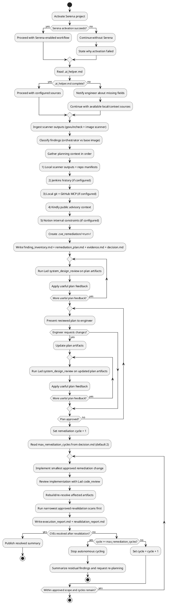

## Working Agreement

Use this skill when the blocker is a CVE/vulnerability finding in Docker/Orchestrator workflows.
The workflow is plan-first and approval-gated: classify findings, prepare a reviewed remediation plan, get engineer approval, then implement and revalidate only approved scope.

## Non-negotiables

1. **Scope**: Use this skill for vulnerability remediation (orchestrator dependency CVEs and image/base-image CVEs), not for generic feature work.
2. **Plan before fix**: Create remediation artifacts first in `.cve_remediation/<YYYYMMDDTHHMMSSZ>_<short_context>/`.
3. **Approval gate**: Do not implement dependency/image/code changes until the plan is Lad-reviewed and explicitly approved by the engineer.
4. **Approved scope only**: Implement only the approved finding set and remediation actions.
5. **Read-only external systems**: Do not write/update external systems (Jenkins, Notion, GitHub) from this skill.
6. **Revalidation-first closure**: Treat findings as resolved only after approved revalidation scans pass for the remediated scope.
7. **Bounded autonomous loop**: If findings remain unresolved after bounded remediation cycles (default max 2), stop and request engineer re-planning.

## Required Tooling

Use these tools when available. If unavailable, ask the engineer for exported evidence and continue with local artifacts.

### Serena
- Activate project first.
- Use repository navigation and memories for context and continuity.

### Lad
- `system_design_review`
- `code_review`

### Kindly (Public Advisory Context)
- `web_search`
- `get_content`

### GitHub (Read-only, optional)
- `search_code`
- `get_file_contents`
- `list_commits`
- `get_commit`

### Jenkins (Read-only, optional)
- `query_items`
- `get_item`
- `get_build`
- `get_build_console_output`
- `get_build_test_report`
- `get_build_parameters`
- `get_running_builds`

### Notion (Read-only, optional)
- `notion-search`
- `notion-fetch`

### Local Scanner Inputs (non-MCP)
- `govulncheck` outputs for Go dependency findings.
- Container image scanner outputs (for example Trivy) for image/base-image findings.

## `.ai_helper.md` Contract

> **`.ai_helper.md` is for infrastructure pointers (server URLs, workspace IDs, repository identity) set up once.** Per-invocation context (finding inputs, target artifacts) comes from the engineer's prompt.

Before external fetches, read repository-root `.ai_helper.md`.
It is the authoritative source for environment-specific pointers used by this skill.

Expected sections/keys (infrastructure only):
- `jenkins` (optional): `base_url`
- `github` (optional): `owner`, `repo`
- `notion` (optional): `workspace_or_search_scope`, `page_ids_or_urls`

Per-invocation context (provided by the engineer in each prompt, not stored in `.ai_helper.md`):
- govulncheck report paths or content
- image scanner report paths or content
- target artifacts (image refs/modules in scope)
- `github.ref` (branch or tag for the current invocation)

Behavior on missing/incomplete `.ai_helper.md`:
- Do not guess endpoints.
- Notify engineer about missing fields.
- Continue with local scan outputs and available configured sources.

## CVE Artifact Set

For each remediation run, create:
- `.cve_remediation/<YYYYMMDDTHHMMSSZ>_<short_context>/finding_inventory.md`
- `.cve_remediation/<YYYYMMDDTHHMMSSZ>_<short_context>/remediation_plan.md`
- `.cve_remediation/<YYYYMMDDTHHMMSSZ>_<short_context>/evidence.md`
- `.cve_remediation/<YYYYMMDDTHHMMSSZ>_<short_context>/decision.md`

After implementation/revalidation, add:
- `.cve_remediation/<YYYYMMDDTHHMMSSZ>_<short_context>/execution_report.md`
- `.cve_remediation/<YYYYMMDDTHHMMSSZ>_<short_context>/revalidation_report.md`

Use UTC timestamp format `YYYYMMDDTHHMMSSZ` and snake_case `short_context`.
If the remediation folder already exists, append `_01`, `_02`, and so on until unique.

## Workflow (Step-by-step)

### 1) Initialize context and access

- Activate Serena if available.
- **Read artifact history context**: see `tdd` Step 1. (List subfolders from all 9 artifact folders, skip any that do not exist, sort by name descending, keep the top 300 in session context. Read folder contents reactively — only when a folder name seems relevant to the current problem.)
- Read `.ai_helper.md` for CVE finding pointers and optional external source pointers.
- If `.ai_helper.md` is incomplete, notify engineer and continue with available context.

### 2) Ingest and classify findings

- Ingest current scanner evidence (govulncheck + image scanner reports).
- Classify findings by remediation surface:
- orchestrator/source dependency finding,
- image/base-image/package finding.
- Build a normalized inventory keyed by finding ID, package/component, current version, fixed version (if known), and affected artifact.

### 3) Gather supporting context (strict order)

Use sources in this order during planning:
1. **Local scanner outputs and repository manifests** (source of truth for current finding state).
2. **Jenkins history** (if configured) for previous scan/build outcomes.
3. **Local git + GitHub MCP** (if configured) for upstream change intent and candidate fix references.
4. **Kindly** for non-GitHub public advisory context (vendor advisories, NVD/OSV-like pages, scanner docs).
5. **Notion internal notes** (if configured) for process/release constraints.

Record evidence references in `evidence.md`.

### 4) Create remediation planning artifacts

- Create `.cve_remediation/<run>/`.
- Write `finding_inventory.md`, `remediation_plan.md`, `evidence.md`, `decision.md`.
- In `remediation_plan.md`, define:
- `selected_finding_scope`
- `proposed_actions` (dependency bump, base image update, package update, acceptable risk/defer with rationale)
- `revalidation_sequence` (narrowest-first)
- `rollback_or_fallback_conditions`
- In `decision.md`, record:
- `status` (`draft` or `approved`)
- `approver`
- `approved_scope`
- `max_remediation_cycles` (default `2` unless approved otherwise)
- `notes`

### 5) Review plan with Lad

- Run Lad `system_design_review` on planning artifacts.
- Apply worthwhile feedback until no material issues remain.

### 6) Ask engineer for explicit approval

- Present reviewed artifacts and proposed remediation order.
- Ask for explicit approval before implementation.
- If changes are requested, revise artifacts and repeat step 5.

### 7) Implement approved remediation

- Apply the smallest approved change first.
- Add/update validation checks where applicable.
- Review implementation changes with Lad `code_review`.
- Keep changes within approved scope.

### 8) Revalidate rebuilt artifacts and decide closure

- Read `max_remediation_cycles` from `.cve_remediation/<run>/decision.md` (default `2` if absent).
- Rebuild/re-resolve as required by approved scope.
- Run narrowest revalidation first:
- affected package/dependency check,
- target image scan,
- broaden only if approved/required.
- Save results to `execution_report.md` and `revalidation_report.md` as cumulative run artifacts (append/update per cycle, do not discard prior cycle evidence).
- If findings are unresolved, increment remediation cycle by `1` and iterate only within approved scope and bounded cycles.

### 9) Re-plan with engineer when needed

- If unresolved findings persist after `max_remediation_cycles`, or evidence becomes contradictory/inconclusive, stop autonomous cycling.
- Summarize findings, residual risk, and required decision points for engineer re-planning.

## Workflow Outputs

Expected outputs:
- Lad-reviewed and engineer-approved CVE remediation plan.
- Approved implementation changes within scope.
- Revalidation evidence tied to the approved finding set.
- Clear resolved/unresolved summary with explicit escalation when needed.

## Workflow Activity Diagram (PlantUML)



## Usage Examples

```text
Classify the current orchestrator and image CVE findings, create approval-ready .cve_remediation artifacts, review with Lad, and wait for my approval before implementation. Follow $percona_cve_remediation_tdd.
```

```text
Use current govulncheck and image scanner outputs to propose a bounded CVE remediation plan, then implement only approved scope and revalidate rebuilt artifacts. Follow $percona_cve_remediation_tdd.
```

## Serena memories (when supported)

Store useful CVE-remediation knowledge for future tasks:
- recurring vulnerable components and successful remediation patterns,
- scanner noise/false-positive signatures,
- safe minimal revalidation command sets,
- approval and escalation decision patterns.

If Serena memories are unavailable, rely on `.ai_helper.md` plus `.cve_remediation/<run>/` artifacts for continuity.
