## Working Agreement

Use this skill when the blocker is deciding whether an Oracle CPU or upstream security fix belongs in an EOL branch, preparing an approval-ready backport plan, and implementing only the approved scope.

The workflow is plan-first and approval-gated: classify candidates, prepare a reviewed classification and backport plan, get engineer approval, then implement only the approved backport scope.

This skill covers the EOL-specific classification and backport work. It does not replace downstream test or sanitizer remediation.

## Non-negotiables

1. **Scope**: Use this skill for Oracle CPU / upstream security fix classification and EOL branch backport planning and implementation — not for normal feature backports or general code changes. The target branch and CVE candidates are provided by the engineer in the prompt.
2. **Plan before fix**: Create classification and backport artifacts first in `.eol_backport/<YYYYMMDDTHHMMSSZ>_<commit_hash>_<short_context>/`.
3. **Approval gate**: Do not apply any backport changes until the classification and plan are Lad-reviewed and explicitly approved by the engineer.
4. **Approved scope only**: Implement only the approved CVE candidate set and backport actions. Do not expand scope.
5. **Read-only external systems**: Do not write/update external systems (Google Sheets, Notion, Jenkins) from this skill.
6. **Narrowest-first validation**: Run the smallest relevant validation after each backport change; broaden only when approved or required.
7. **Escalate on ambiguity or scope expansion**: If applicability cannot be justified, the fix requires broader refactoring than EOL backport allows, or security classification is ambiguous, stop and escalate rather than proposing a low-confidence plan.
8. **Handoff to downstream skills**: If the approved backport triggers test failures, build/sanitizer issues, or merge conflicts, hand off to the appropriate skill and stop.

## Required Tooling

Use these tools when available. If unavailable, ask the engineer for exported evidence and continue with local artifacts.

### Serena
- Activate project first.
- Use repository navigation and memories for context and continuity.

### Lad
- `system_design_review`
- `code_review`

### Kindly (Public Advisory Context)
- `web_search`
- `get_content`

### GitHub (Read-only)
- `search_code`
- `get_file_contents`
- `list_commits`
- `get_commit`

### Local Git (CLI)
- `git log`, `git show`, `git diff`, `git blame` around upstream commit context and affected files.

### Google Sheets (Read-only)
- `sheets_get_metadata`
- `sheets_get_values`
- `sheets_batch_get_values`

### Jenkins (Read-only)
- `query_items`
- `get_item`
- `get_build`
- `get_build_console_output`
- `get_build_test_report`
- `get_build_parameters`
- `get_running_builds`

### Notion (Read-only)
- `notion-search`
- `notion-fetch`

## `.ai_helper.md` Contract

The target branch and CVE candidates are provided by the engineer in the prompt.

**Scope of `.ai_helper.md`:** `.ai_helper.md` is for infrastructure pointers (server URLs, workspace IDs, repository identity) set up once. Per-invocation context (target branch, upstream ref, CVE candidates) comes from the engineer's prompt.

**Infrastructure (set up once in `.ai_helper.md`):**
- `github`: `owner`, `repo`
- `google_sheets`: `spreadsheet_id_or_url`, `sheet_name`, `ranges`
- `notion`: `workspace_or_search_scope`, `page_ids_or_urls`
- `jenkins`: `base_url`

**Per-invocation context (provided by engineer in prompt):**
- `target_branch`: target EOL branch (e.g., `ps-5.7`, `percona-5.7`)
- `eol_branch_ref`: specific git ref (branch name, tag, or SHA) for the EOL branch, used for null-merge comparison baseline
- `upstream_ref`: upstream git ref for the release that includes the fix, used for null-merge comparison
- `cve_candidates`: paths or links to Oracle CPU CVE list, upstream security commits, or candidate commit SHAs
- `github.ref`: upstream git ref (branch/tag/SHA) for the release that includes the fix

Behavior on missing/incomplete `.ai_helper.md`:
- Do not guess endpoints or CVE IDs.
- Notify engineer about missing fields.
- Continue with local evidence and available configured sources.

## EOL Backport Artifact Set

For each backport run, create:
- `.eol_backport/<YYYYMMDDTHHMMSSZ>_<commit_hash>_<short_context>/classification_matrix.md`
- `.eol_backport/<YYYYMMDDTHHMMSSZ>_<commit_hash>_<short_context>/backport_plan.md`
- `.eol_backport/<YYYYMMDDTHHMMSSZ>_<commit_hash>_<short_context>/evidence.md` — required minimum fields per entry: CVE ID (if applicable), source name, date fetched, relevant snippet, and classification rationale. If sources conflict, note the conflict and explain which source was given priority and why. Required for null-merge classification: include the file-content comparison snippet proving the fix is already present.
- `.eol_backport/<YYYYMMDDTHHMMSSZ>_<commit_hash>_<short_context>/decision.md`

After implementation, add:
- `.eol_backport/<YYYYMMDDTHHMMSSZ>_<commit_hash>_<short_context>/execution_report.md`
- `.eol_backport/<YYYYMMDDTHHMMSSZ>_<commit_hash>_<short_context>/patch_inventory.md` with fields per patch entry: `candidate_id` (CVE ID or commit SHA), `run_folder`, `upstream_sha`, `local_sha`, `backport_method` per file for multi-file CVEs (e.g., `file_a.cc: null-merge; file_b.cc: cherry-pick`), or a single method if the whole CVE is one action, `classification`, `validation_outcome` (one of `pass`, `fail`, `skipped`, `escalated`), and any notes per patch

Use UTC timestamp format `YYYYMMDDTHHMMSSZ`, the `<commit_hash>` from `git rev-parse --short=12` of the first upstream commit being classified/backported, and snake_case `short_context`.
If the run folder already exists, append `_01`, `_02`, and so on until unique.

## Workflow (Step-by-step)

### 1) Initialize context and access

- Activate Serena if available.
- **Read artifact history context**: see `tdd` Step 1. (List subfolders from all 9 artifact folders, skip any that do not exist, sort by name descending, keep the top 300 in session context. Read folder contents reactively — only when a folder name seems relevant to the current problem.)
- Read `.ai_helper.md` for EOL target branch, CVE candidate pointers, and optional external source pointers.
- If `.ai_helper.md` is incomplete, notify engineer and continue with available context.

### 2) Gather classification context

- Collect the Oracle CPU CVE list or upstream security commit candidates.
- Before applying any patches, run a baseline validation: at minimum, compile the target area (e.g., `cd sql && make` for SQL-layer changes). Record baseline state in `evidence.md` as `baseline_pass` or `baseline_fail_with_N_pre-existing_failures`. This establishes a reference point to distinguish pre-existing failures from backport-induced failures.
- Use sources in this order:
  1. **Upstream git/release notes** — local git first, then GitHub MCP, then Kindly fallback — for commit context and release scope. Upstream commit context (what the fix actually changes) takes priority over advisory narrative for code-impact classification.
  2. **Google Sheets EOL security triage history** for prior classifications and decisions.
  3. **Oracle CPU CVE pages** via Kindly for advisory details and fixed versions.
  4. **Internal process docs/notes** via Notion for EOL criteria and constraints.
  5. **Jenkins validation history** for prior backport validation outcomes.
- Record evidence (Sheets triage rows, CVE page snippets, commit metadata, Jenkins history entries) in `evidence.md` following the field contract in the artifact description above.

### 3) Classify candidates and create planning artifacts

- Classify each candidate CVE/commit as:
  - **in scope + applicable**: fix applies to the EOL codebase, EOL branch is affected, backport is safe under EOL constraints.
  - **out of scope / not applicable**: not relevant to EOL branch, already superseded, or risk too high for EOL backport.
  - **uncertain**: insufficient evidence to classify. Record the candidate in `classification_matrix.md` with classification `uncertain` and a `flag: escalate` marker. Present the evidence to the engineer for resolution **before** the plan goes to the approval gate. If the engineer resolves it (reclassifies to `in_scope_applicable` or `out_of_scope_not_applicable`), proceed. If the engineer cannot resolve it, set `status: escalated` in `decision.md` and exit — do not loop indefinitely waiting for resolution.
- Identify upstream dependencies for each in-scope candidate. If a dependency is missing from the EOL branch, flag it in `classification_matrix.md` as a risk; the dependency must also be planned for backport or the candidate reclassified. If a candidate's dependency is classified `out_of_scope_not_applicable`, reclassify the candidate as `uncertain: escalate` and document the dependency conflict. Stop dependency recursion when a dependency is already satisfied in the EOL branch (null-merge case) or outside the approved scope.
- Create `.eol_backport/<YYYYMMDDTHHMMSSZ>_<commit_hash>_<short_context>/`.
- Derive `<commit_hash>` from `git rev-parse --short=12` of the first upstream commit being classified.
- If the run folder already exists, append `_01`, `_02`, and so on until unique.
- Write `classification_matrix.md`, `backport_plan.md`, `evidence.md`, `decision.md`.
- In `classification_matrix.md`, record:
  - each candidate CVE ID or commit SHA
  - classification (`in_scope_applicable`, `out_of_scope_not_applicable`, or `uncertain`)
  - justification and evidence references
  - EOL applicability rationale (why the fix applies, how it was adapted if needed)
  - risk notes for each candidate
- In `backport_plan.md`, define:
  - `selected_candidates` (from in-scope set)
  - `dependencies` (upstream dependencies identified; each must be planned for backport or the candidate reclassified)
  - `adaptation_steps` (what changes were made from upstream to fit EOL branch)
  - `proposed_actions` per candidate — one of:
    - `cherry-pick`: apply upstream commit directly to EOL branch
    - `manual port`: adapt upstream changes to match EOL code structure
    - `null-merge`: the CVE fix is already present in the EOL branch. Before classifying as null-merge, verify by comparing the EOL file content against the upstream fixed version using `git show <eol_branch>:<path>` vs. `git show <upstream_commit>:<path>` (or a diff between the EOL branch tag and the upstream release tag that includes the fix). Include the comparison snippet in `evidence.md` proving the fix is functionally identical. Record the decision with justification. For multi-file CVEs, null-merge can be declared per-file: some files may be null-merged while others require cherry-pick or manual port. If file paths differ between upstream and EOL due to refactoring, treat as manual port unless functional equivalence can be proven.
    - `skip`: do not apply; reason recorded (e.g., dependency unresolvable, risk too high)
  - `validation_sequence` (narrowest-first)
  - `rollback_conditions` — explicit conditions that trigger reverting the backport change (e.g., "build fails after revert", "deterministic MTR regression appears in the affected test suite", "ASAN report introduced"). When a rollback condition is triggered, use `git revert <local_sha>` to create a reversing commit, or manually restore the pre-backport state; record the method in `execution_report.md`.
- In `decision.md`, record:
  - `status` (`draft`, `approved`, `rejected`, or `escalated`)
  - `approver` — name or GitHub handle of the engineer who provided explicit approval
  - `approved_candidates` — subset of in-scope candidates the engineer approved; if the engineer approves only a subset, update this field and implement only the approved subset (do not expand scope)
  - `backport_cycle` (incremented each time a candidate fails validation and is re-planned; resets to `0` on approval. Note: plan-revision cycles during the approval gate (steps 4-5) do not count against this counter — only post-approval validation failures increment it. Because the counter resets on re-approval, each re-plan grants a fresh attempt budget up to `max_backport_cycles` per candidate)
  - `max_backport_cycles` (default `2`; after this many failed attempts for a single candidate, stop and escalate to the engineer)
  - `max_revision_cycles` (default `3`; after this many plan-revision rounds during the approval gate without approval, summarize and ask the engineer for a definitive decision)
  - `failure_record` (appended on step-8 validation failure: candidate name, validation command that failed, failure evidence, current cycle count)
  - `notes`

### 4) Review plan with Lad

- Run Lad `system_design_review` on planning artifacts.
- Apply worthwhile feedback until no material issues remain. Maximum `max_revision_cycles` Lad review rounds (default `3`); after this, proceed to engineer approval regardless and note any remaining Lad flags in `decision.md` notes.
- If Lad flags an issue and the engineer disagrees, engineer approval takes precedence; document the disagreement in `decision.md` notes and proceed if the engineer confirms.

### 5) Ask engineer for explicit approval

- Present reviewed classification matrix and backport plan.
- Ask for explicit approval before applying any changes.
- If changes are requested, revise artifacts and repeat step 4. After `max_revision_cycles` revision rounds without approval, summarize the current state, open issues, and remaining options and ask the engineer for a definitive decision before continuing.
- If the engineer declines to approve the plan, set `status: rejected` in `decision.md` and exit.

### 6) Implement approved backport

- Apply approved candidates in dependency order first, then by estimated diff size ascending within each dependency tier. Candidates with unresolvable dependencies must be resolved or reclassified before any dependent candidate is applied.
- Follow `tdd` discipline: if the backported fix lacks coverage in the EOL branch's test suite, write focused regression tests for the backported area only. New test additions covering approved backport changes do not constitute scope expansion. Do not add tests for unrelated areas. Review tests with Lad `code_review`.
- Implement the backport change.
- Review implementation with Lad `code_review`.
- Keep changes within approved scope.

### 7) Validate narrowest-first

- Run the smallest relevant validation first:
  1. affected object/file compile check (e.g., `make <target>` for the touched object or `make` for the affected Makefile target),
  2. focused test check for the backported area (e.g., `mtr --suite=<suite> --test-case=<test>` for an MTR test; `make test-run-nosync STRICT_MEMORY=1` for a unit test),
  3. broaden only if approved or required.
- Record results in `execution_report.md` and update `patch_inventory.md` with the applied patch entry (upstream_sha, local_sha, backport_method, classification, validation_outcome).

### 8) Repeat for remaining approved candidates

- Continue applying and validating each approved candidate in order.
- Update `execution_report.md` and `patch_inventory.md` cumulatively (each patch entry: upstream_sha, local_sha, backport_method, classification, validation_outcome).
- If a candidate fails validation:
  - Increment `backport_cycle` in `decision.md`.
  - If `backport_cycle` >= `max_backport_cycles`, stop and escalate to step 9.
  - Otherwise, record the failure and escalate to step 9 for the engineer to decide whether to skip, re-plan, or retry.
- If a candidate fails to apply due to an unresolved upstream dependency not captured in the classification matrix, record the new dependency in `classification_matrix.md` with `flag: escalate`, set `status: escalated` in `decision.md`, and stop implementation of that candidate pending resolution.
- After all approved candidates are applied, run a cumulative validation: compile the specific make target for each affected subdirectory (e.g., `make -C sql` for a SQL-layer change, `make -C storage/innobase` for an InnoDB change) and run focused tests across all backported areas to catch cross-candidate regressions.

### 9) Hand off or escalate

- If all approved candidates are applied and validated:
  - Present the completed `patch_inventory.md` and `execution_report.md`.
  - Check all downstream conditions: test failures, build/sanitizer issues, and merge conflicts may co-occur. Collect all applicable handoff targets and present them to the engineer. If multiple handoffs apply, the engineer decides the priority order.
  - If the backport is complete with no downstream issues, confirm completion to the engineer.
- If a candidate cannot be applied or validated:
  - Update `decision.md` with `status: escalated`.
  - Summarize the failure, evidence, and remaining options.
  - Request explicit engineer direction.

## Handoff Rules

- If the approved backport introduces **new** (not pre-existing in baseline) deterministic test failures, `percona_mtr_remediation_tdd` is a potential handoff.
- If the approved backport introduces build, ASAN, or Valgrind fallout, `percona_asan_build_remediation_tdd` is a potential handoff.
- If the backport introduces or surfaces merge conflict or conflict-interpretation issues (whether during landing or in subsequent merge operations), `percona_conflict_resolution_tdd` is a potential handoff.
- Multiple handoff targets may apply simultaneously; present all applicable ones to the engineer for priority ordering.
- If the handoff target skill is not found in `solution/skills/`, notify the engineer and pause escalation until the skill is available.

## Workflow Outputs

Expected outputs:
- Lad-reviewed and engineer-approved classification matrix.
- Lad-reviewed and engineer-approved backport plan.
- Applied backport changes within approved scope.
- `patch_inventory.md` listing all applied patches and validation outcomes.
- Clear downstream handoff package for validation or remediation if needed.

## Workflow Activity Diagram (PlantUML)

```plantuml
@startuml
start

:Activate Serena project;
if (Serena activation succeeds?) then (yes)
  :Proceed with Serena-enabled workflow;
else (no)
  :Continue without Serena;
  :State why activation failed;
endif

:Read .ai_helper.md;
if (.ai_helper.md complete?) then (yes)
  :Proceed with configured sources;
else (no)
  :Notify engineer about missing fields;
  :Continue with available local/context sources;
endif

:Gather classification context;
:1) Upstream git/release notes;
:2) Google Sheets EOL triage history;
:3) Oracle CPU CVE pages via Kindly;
:4) Internal process docs via Notion;
:5) Jenkins validation history;

:Create .eol_backport/<YYYYMMDDTHHMMSSZ>_<commit_hash>_<short_context>/;
:Write classification_matrix.md + backport_plan.md + evidence.md + decision.md;

repeat
  :Run Lad system_design_review on plan artifacts;
  :Apply useful plan feedback;
repeat while (More useful plan feedback?) is (yes)

repeat
  :Present reviewed classification matrix and backport plan to engineer;
  if (Engineer requests changes?) then (yes)
    :Update plan artifacts;
    :Run Lad system_design_review on updated plan artifacts;
    repeat
      :Apply useful plan feedback;
      :Re-run Lad system_design_review if artifacts changed;
    repeat while (More useful plan feedback?) is (yes)
  endif
repeat while (Plan approved?) is (no)

:Set candidate_index = 1;
:Set backport_cycle = 0;
:Set max_backport_cycles = 2;
note right: backport_cycle resets to 0 on approval;
note right: escalate to engineer if backport_cycle >= max_backport_cycles;

repeat
  :Implement smallest approved candidate;
  :Write/update tests where applicable;
  :Review tests with Lad code_review if applicable;
  :Review implementation with Lad code_review;
  :Run narrowest-first validation;
  :1) make <target> compile check;
  :2) mtr --suite=<suite> --test-case=<test> or equivalent focused test;
  :3) broaden only if approved/required;
  :Update execution_report.md + patch_inventory.md;

  if (Validation passes?) then (yes)
    :Increment candidate_index;
  else (no)
    :Increment backport_cycle in decision.md;
    if (backport_cycle >= max_backport_cycles?) then (yes → limit reached)
      :Update decision.md: status = escalated;
      :Summarize failure, evidence, and remaining options;
      :Request explicit engineer direction;
      stop
    else (no → retries available)
      :Record failure in execution_report.md;
      :Escalate to engineer for skip/re-plan/retry;
      :Get engineer decision;
      :Re-plan for this candidate;
      :Lad system_design_review on updated plan;
      :Apply updated plan;
    endif
  endif
repeat while (candidate_index <= approved_candidate_count?) is (yes)

:Run cumulative validation across all applied patches;
:1) compile full affected area;
:2) run focused tests across all backported areas;
:3) catch cross-candidate regressions;

:Present completed patch_inventory.md and execution_report.md;
:Check all downstream conditions;
note right: test failures, build/ASAN issues, and merge conflicts may co-occur;

if (Any downstream issues?) then (yes)
  if (Test failures appear?) then (yes)
    :Flag percona_mtr_remediation_tdd handoff;
  endif
  if (Build/ASAN/Valgrind issues appear?) then (yes)
    :Flag percona_asan_build_remediation_tdd handoff;
  endif
  if (Merge conflicts emerge?) then (yes)
    :Flag percona_conflict_resolution_tdd handoff;
  endif
  :Present all flagged handoffs to engineer;
  :Engineer decides priority order;
  stop
else (no)
endif

:Confirm completion to engineer;
stop
@enduml
```



## Usage Examples

```text
Review the current Oracle CPU candidate list for MySQL 5.7 applicability, prepare an approval-ready backport plan with classification matrix, and implement only the approved backports. Follow $percona_eol_security_backport_tdd.
```

```text
Assess whether this upstream security commit belongs in the EOL branch, prepare the evidence package and classification matrix, and after approval land the narrowest safe backport. Follow $percona_eol_security_backport_tdd.
```

## Serena memories (when supported)

Store useful EOL backport knowledge for future tasks:
- recurring Oracle CPU classification patterns and accepted decisions,
- EOL-specific adaptation patterns (what changes survive vs. require rework),
- safe minimal validation command sets for backport verification,
- escalation patterns for ambiguous or out-of-scope candidates.