## Working Agreement

Use this skill when the blocker is a deterministic or mostly deterministic MTR/unit failure in Percona merge workflows.
The workflow is plan-first and approval-gated: build a reviewed remediation plan, get engineer approval, then implement only approved scope.

## Non-negotiables

1. **Scope**: Use this skill only for deterministic or mostly deterministic MTR/unit failures.
2. **Plan before fix**: Create remediation artifacts first in `.mtr_remediation/<YYYYMMDDTHHMMSSZ>_<short_context>/`.
3. **Approval gate**: Do not implement code changes until the plan is Lad-reviewed and explicitly approved by the engineer.
4. **Approved scope only**: Implement only the approved remediation scope for the current failing test/batch.
5. **Rerun-first validation**: Rerun the selected failing test first; broaden reruns only when required by the approved plan.
6. **Read-only external systems**: Do not write/update external systems (Jenkins, Notion, Google Sheets) from this skill.
7. **Engineer-driven re-planning**: If evidence indicates out-of-scope root cause or persistent non-determinism, stop and ask the engineer for re-planning instructions.

## Required Tooling

Use these tools when available. If unavailable, ask the engineer for exported evidence and continue with local artifacts.

### Serena
- Activate project first.
- Use repository navigation and memories for context and continuity.

### Lad
- `system_design_review`
- `code_review`

### GitHub (Read-only)
- `search_code`: find upstream code references for failing signatures and touched paths.
- `get_file_contents`: read upstream file content (or directory listing) at path + optional `ref`/`sha`.
- `list_commits`: inspect upstream commit history on branch/tag/sha.
- `get_commit`: inspect exact commit intent, changed files, and patch context.

### Kindly (Fallback For Non-GitHub Public Context)
- `web_search`
- `get_content`

### Google Sheets (Read-only)
- `sheets_get_metadata`
- `sheets_get_values`
- `sheets_batch_get_values`

### Jenkins (Read-only)
- `query_items`
- `get_item`
- `get_build`
- `get_build_console_output`
- `get_build_test_report`
- `get_build_parameters`
- `get_running_builds`

### Notion (Read-only)
- `notion-search`
- `notion-fetch`

## `.ai_helper.md` Contract

Before any external fetch, read repository-root `.ai_helper.md`.
It is the authoritative source for **infrastructure pointers** (server URLs, workspace IDs, repository identity) used by this skill. Infrastructure pointers are set up once and don't change between invocations.

Per-invocation context comes from the engineer's prompt — do not expect it in `.ai_helper.md`. When the engineer invokes this skill, the prompt should include:
- The failing test name or batch
- The target branch or environment
- Any relevant upstream context (release notes, bug links, keywords)

Expected sections/keys in `.ai_helper.md`:
- `jenkins` (optional but recommended): `base_url`
- `google_sheets` (optional but recommended): `spreadsheet_id_or_url`, `sheet_name`, `ranges`
- `notion` (optional): `workspace_or_search_scope`, `page_ids_or_urls`
- `github` (optional but recommended): `owner`, `repo`

Behavior on missing/incomplete `.ai_helper.md`:
- Do not guess external endpoints.
- If infrastructure sections (`jenkins`, `google_sheets`, `notion`) are missing/incomplete, inform the engineer and continue the workflow using local evidence plus any configured/available sources.
- If optional sections (`github`, `upstream_context`) are missing/incomplete, inform the engineer and continue with available context (local git first, then remaining configured sources).

## MTR Artifact Set

For each remediation run, create:
- `.mtr_remediation/<YYYYMMDDTHHMMSSZ>_<short_context>/mtr_plan.md`
- `.mtr_remediation/<YYYYMMDDTHHMMSSZ>_<short_context>/failing_tests.md`
- `.mtr_remediation/<YYYYMMDDTHHMMSSZ>_<short_context>/evidence.md`
- `.mtr_remediation/<YYYYMMDDTHHMMSSZ>_<short_context>/decision.md`

After implementation/reruns, add:
- `.mtr_remediation/<YYYYMMDDTHHMMSSZ>_<short_context>/execution_report.md`
- `.mtr_remediation/<YYYYMMDDTHHMMSSZ>_<short_context>/rerun_results.md`

Use UTC timestamp format `YYYYMMDDTHHMMSSZ` and snake_case `short_context`.
If the remediation folder already exists, append `_01`, `_02`, and so on until unique.

## Workflow (Step-by-step)

### 1) Initialize context and access

- Activate Serena if available.
- **Read artifact history context**: see `tdd` Step 1. (List subfolders from all 9 artifact folders, skip any that do not exist, sort by name descending, keep the top 300 in session context. Read folder contents reactively — only when a folder name seems relevant to the current problem.)
- Read `.ai_helper.md` and validate required keys for Jenkins/Sheets/Notion.
- If required keys are missing, notify engineer and continue with local evidence plus any available configured sources.
- If optional GitHub configuration is missing, continue with local git and use Kindly fallback for non-GitHub public context.

### 2) Investigate local failure context

- Inspect local failing-test outputs and repository state.
- Identify the current failing test/batch and touched files/commits.
- Summarize deterministic vs non-deterministic signals.

### 3) Gather planning context from external sources (strict order)

Use external assets in this order during planning:
1. **Jenkins history** (prior failure patterns and signatures).
2. **Merge tracking Google Sheets notes** (known test issues and prior annotations).
3. **Upstream/percona history** (local git context first, then GitHub MCP for upstream repository reads, then Kindly fallback when needed).
4. **Notion/internal process notes** (constraints and caveats).

Operational detail for each source:

1. **Jenkins (from `.ai_helper.md` -> `jenkins.base_url`)**
- MCP server: Jenkins
- Tools and sequence:
- `query_items` to confirm job paths visibility.
- `get_item` for selected job metadata.
- `get_build` for target builds.
- `get_build_test_report` for failing tests/signatures.
- `get_build_console_output` for error context when needed.
- `get_build_parameters` for run configuration context.
- `get_running_builds` only to avoid reading unstable in-progress runs.

2. **Google Sheets (from `.ai_helper.md` -> `google_sheets.spreadsheet_id_or_url`, `google_sheets.sheet_name`, optional `google_sheets.ranges`)**
- MCP server: Google Sheets
- Tools and sequence:
- `sheets_get_metadata` to confirm tab names and structure.
- If `ranges` are provided, use `sheets_batch_get_values`.
- If `ranges` are not provided, use `sheets_get_values` on the configured `sheet_name`.
- Read only merge-tracking rows relevant to failing test(s), known issues, and prior annotations.
- If Google Sheets is unavailable (for example permission/network/not-found), inform the user, record this limitation in `evidence.md`, and continue the workflow using Jenkins + local/upstream context + Notion without stopping.

3. **Upstream/percona context**
- Local sources first (CLI git): `git log`, `git show`, `git diff`, `git blame` around touched files and failing tests.
- MCP server: GitHub
- Tools and sequence:
- `search_code` scoped to `repo:<owner>/<repo>` when `.ai_helper.md` provides `github.owner` and `github.repo`; use this to find upstream references for failing tests/signatures and touched paths.
- `list_commits` using `owner/repo` and optional `sha` from `.ai_helper.md` `github.ref` to inspect branch-level upstream change flow.
- `get_commit` for exact upstream commits selected from local/git or list results, to inspect intent and changed files.
- `get_file_contents` for exact paths and optional `ref` from `.ai_helper.md` `github.ref` when local history is insufficient.
- MCP server: Kindly (fallback only)
- Use `web_search` and `get_content` only for non-GitHub public sources (for example `bugs.mysql.com`, Oracle release-note pages) or when GitHub MCP cannot provide required context.

4. **Notion (from `.ai_helper.md` -> `notion.page_ids_or_urls` and/or `notion.workspace_or_search_scope`)**
- MCP server: Notion
- Tools and sequence:
- If `page_ids_or_urls` are provided, fetch them directly with `notion-fetch`.
- If only scope/keywords are available, use `notion-search` first, then `notion-fetch` for selected pages.
- Extract only process constraints/caveats relevant to current failing test and remediation scope.

Record gathered evidence links/snippets in `evidence.md`.

### 4) Create remediation planning artifacts

- Create `.mtr_remediation/<run>/`.
- Write `mtr_plan.md`, `failing_tests.md`, `evidence.md`, `decision.md`.
- In `mtr_plan.md`, define:
- `selected_failing_target`
- `root_cause_hypothesis`
- `test_first_validation_sequence`
- `broadened_rerun_criteria`
- In `decision.md`, record:
- `status` (`draft` or `approved`)
- `approver`
- `approved_scope`
- `notes`

### 5) Validate assumptions and review plan

- Validate assumptions with local git evidence and GitHub MCP first.
- Use Kindly only when needed for non-GitHub public references.
- Update `mtr_plan.md` and `evidence.md` when assumptions change.
- Run Lad `system_design_review` on planning artifacts.
- Apply worthwhile feedback until no material issues remain.

### 6) Ask engineer for explicit approval

- Present the reviewed plan and artifact set.
- Ask for explicit approval before implementation.
- If changes are requested, revise artifacts and repeat step 5.

### 7) Implement approved remediation

- Apply the smallest approved change first.
- Write/update tests first where applicable.
- Review tests with Lad `code_review`.
- Implement code change.
- Review implementation with Lad `code_review`.

### 8) Validate with rerun-first strategy

- Run the selected failing test first.
- If still failing, record outcome and iterate only within approved scope.
- If passing, broaden reruns only as approved.
- During validation, use sources in this order when needed:
1. Approved local plan + local rerun outputs.
2. Jenkins historical comparison for regression sanity.
3. Merge Sheets notes only if behavior looks historically flaky or ambiguous.
- Save `execution_report.md` and `rerun_results.md`.

### 9) Re-plan with engineer when needed

- If evidence shows out-of-scope root cause or persistent non-determinism, stop autonomous cycling.
- Summarize findings and ask engineer for explicit re-planning direction.

## Workflow Outputs

Expected outputs:
- Lad-reviewed and engineer-approved MTR remediation plan.
- Approved implementation changes within scope.
- Targeted rerun evidence (single-test first, broadened only when approved).
- Clear pass/fail/inconclusive summary and explicit request for re-planning when needed.

## Workflow Activity Diagram (PlantUML)

```plantuml
@startuml
start

:Activate Serena project;
if (Serena activation succeeds?) then (yes)
  :Proceed with Serena-enabled workflow;
else (no)
  :Continue without Serena;
  :State why activation failed;
endif

:Read .ai_helper.md;
if (.ai_helper.md complete?) then (yes)
  :Proceed with external sources;
else (no)
  :Request engineer to fix .ai_helper.md;
  :Continue with local evidence and available sources;
endif

:Investigate local failing-test context;

:Gather planning context in order;
:1) Jenkins history;
:2) Merge Sheets notes;
:3) Upstream/percona context (local git + GitHub MCP; Kindly fallback);
:4) Notion/internal notes;

:Create .mtr_remediation/<run>/;
:Write mtr_plan.md + failing_tests.md + evidence.md + decision.md;

:Validate assumptions with local git and GitHub MCP first;
:Use Kindly only when needed for non-GitHub public context;
:Update mtr_plan.md and evidence.md if needed;

repeat
  :Run Lad system_design_review on plan artifacts;
  :Apply useful plan feedback until no material issues remain;
repeat while (More useful plan feedback?) is (yes)

repeat
  :Present reviewed plan to engineer;
  if (Engineer requests changes?) then (yes)
    :Update plan artifacts;
    repeat
      :Run Lad system_design_review on updated plan artifacts;
      :Apply useful plan feedback until no material issues remain;
    repeat while (More useful plan feedback?) is (yes)
  endif
repeat while (Plan approved?) is (no)

repeat
  :Write/update tests for approved scope;
  :Review tests with Lad code_review;
  :Implement approved remediation change;
  :Review implementation with Lad code_review;
  :Run selected failing test first;
  if (Selected test passes?) then (yes)
    :Run broadened reruns only when approved;
  else (no)
    :Record selected-test failure in rerun_results.md;
  endif
  :Compare with Jenkins history;
  :Check merge Sheets only for flaky/ambiguous behavior;
  if (Out-of-scope root cause OR persistent non-determinism?) then (yes)
    :Stop autonomous cycling;
    :Summarize findings for engineer;
    :Ask engineer for re-planning direction;
    stop
  endif
  :Write execution_report.md + rerun_results.md;
repeat while (Approved remediation scope remaining?) is (yes)

:Publish pass/fail/inconclusive summary;
stop
@enduml
```



## Usage Examples

```text
Analyze the current failing MTR batch, create .mtr_remediation artifacts using .ai_helper.md sources, review the plan with Lad, and wait for my approval before implementation. Follow $percona_mtr_remediation_tdd.
```

```text
Take the selected failing test, use Jenkins and merge-sheet history from .ai_helper.md to build an approval-ready remediation plan, then run single-test-first validation for approved changes. Follow $percona_mtr_remediation_tdd.
```

## Serena memories (when supported)

Store useful remediation knowledge for future tasks:
- deterministic vs flaky signatures seen in this repo,
- reliable minimal rerun commands,
- recurring remediation patterns,
- approval and re-planning decision patterns.
